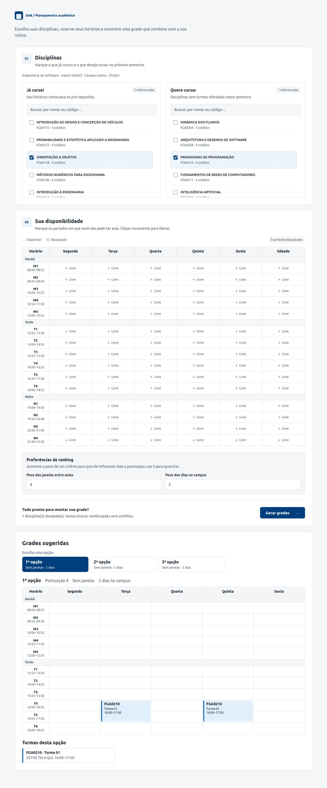

# Planejador Inteligente de Grade Horária da UnB

O [relatório de entrega](RELATORIO.md) segue as 13 seções do modelo da disciplina:
identificação, resumo, execução, arquitetura, Prolog, Elm, integração, testes,
limitações, contribuições, fontes e IA, apresentação e reflexão.
Os campos de GitHub, IA e demais dados pendentes serão completados pelo grupo.



```
prolog/regras.pl     P1  restrições (choques, pré-requisitos, créditos)
prolog/ranking.pl    P2  ranking e Top 5
prolog/turmas.pl     P3  base de turmas
backend/             P3  API (uv + janus_swi)
frontend/src/        P4, P5, P6  Elm
frontend/tests/      P7  elm-test
prolog/tests/        P7  plunit
docs/                P7  apresentação
```

## Implementado até o momento

- **Regras Prolog:** geração de grades sem choques, respeitando pré-requisitos,
  créditos, vagas e horários bloqueados, com CLP(FD).
- **Ranking Prolog:** retorno de até cinco grades válidas, com pontuação
  configurável por peso de janelas e de dias no campus; quanto menor, melhor.
- **Catálogo e turmas.** O catálogo curricular contém 42 disciplinas obrigatórias
  e 60 optativas da Engenharia de Software da FCTE. A geração de grades usa
  162 turmas de 66 disciplinas do Campus Gama ofertadas em 2026/2.
- **Interface Elm:** seleção de disciplinas cursadas e desejadas, grade clicável
  para horários bloqueados, pesos configuráveis para janelas e dias no campus e
  ciclo HTTP com estados de carregamento, erro e resultados. A interface carrega
  as disciplinas pela API.
- **API Python.** O FastAPI recebe a requisição do Elm e consulta o motor
  Prolog via Janus para retornar as grades sugeridas.

## Estrutura

| Caminho | Conteúdo | Responsáveis |
| --- | --- | --- |
| `prolog/regras.pl` | Restrições de montagem da grade com CLP(FD) | P1 |
| `prolog/ranking.pl` | Cálculo da pontuação e seleção das melhores grades | P2 |
| `prolog/turmas.pl` | Base demonstrativa para os testes e carregamento da oferta para a API | P3 |
| `backend/server.py` | API FastAPI que consulta o Prolog via janus | P3 |
| `backend/tests/` | Testes da importação e integração Python–Prolog com a oferta real | P7 |
| `backend/catalogo_unb.json` | Catálogo curricular da Engenharia de Software da FCTE | P3 |
| `backend/oferta_sigaa_2026_2.json` | Horários e vagas da oferta do Campus Gama | P3 |
| `frontend/src/` | Interface Elm | P4, P5, P6 |
| `frontend/tests/` | Testes Elm | P7 |
| `prolog/tests/` | Testes PlUnit de regras e ranking | P7 |
| `docs/` | Pasta reservada para a apresentação | P7 |

## Executar com Docker Compose

Instale o Docker com o plugin Compose. No Windows, abra o Docker Desktop e
use contêineres Linux. Não é necessário instalar Python, SWI-Prolog, Node.js
ou Elm na máquina para usar este caminho.

Na raiz do repositório:

```sh
docker compose up --build -d --wait
```

Abra o [planejador](http://127.0.0.1:8000/) ou o
[Swagger](http://127.0.0.1:8000/docs). A primeira construção baixa imagens e
dependências, compila o Elm e instala a integração Janus com o SWI-Prolog.
O comando espera a API responder ao teste de saúde antes de terminar.

```sh
docker compose logs -f app
docker compose down
```

O primeiro comando acompanha os logs; encerre esse acompanhamento com
Ctrl+C. O segundo para e remove o contêiner da aplicação. Após editar o
código, execute novamente `docker compose up --build -d --wait`.

Se a porta 8000 estiver ocupada, no PowerShell defina `$env:PORTA = "8001"`
antes de subir e acesse `http://127.0.0.1:8001/`.

### Testes pelo Docker

Na raiz, rode as três suítes com um comando:

```sh
docker compose run --build --rm testes
```

O serviço de testes executa PlUnit, pytest e elm-test, nessa ordem, e termina
com código diferente de zero se uma suíte falhar. Ele usa os dados
versionados e o motor Prolog real; não depende da aplicação estar aberta.
O perfil `testes` mantém esse serviço fora da inicialização normal.

Para executar uma suíte isoladamente:

```sh
docker compose run --build --rm testes swipl -s prolog/tests/regras.pl -s prolog/tests/ranking.pl -s prolog/tests/oferta.pl -g run_tests -t halt
docker compose run --build --rm -w /app/backend testes python -m pytest -q
docker compose run --build --rm -w /app/frontend testes elm-test
```

A formatação é uma verificação separada; este comando apenas aponta os
arquivos fora do padrão, sem alterá-los:

```sh
docker compose run --build --rm -w /app/frontend testes elm-format --validate src tests
```

O Dockerfile separa a compilação Elm, a instalação Python/Janus, a aplicação
e as ferramentas de teste. As dependências usam `backend/uv.lock` e
`frontend/package-lock.json`; Elm e elm-test estão fixados em `0.19.2-0`.
O `uv` segue a [integração oficial com Docker](https://docs.astral.sh/uv/guides/integration/docker/).
O Debian Trixie fornece o [SWI-Prolog 9.2.9](https://packages.debian.org/trixie/swi-prolog-nox).

Docker ajuda a reproduzir a execução e os testes pedidos nas seções 3 e 8
do relatório. O relatório, a demonstração no navegador e o validador de
entrega continuam sendo verificações próprias. Os testes existentes não
automatizam a navegação pela interface.

## Executar a interface com a API sem Docker

### Pré-requisitos

- SWI-Prolog >= 9.1.12 com `swipl` no `PATH`, exigido pelo Janus. A execução foi verificada com a versão 11.0.1.
- `uv` para configurar o ambiente Python. [Instalação do uv](https://docs.astral.sh/uv/getting-started/installation/)
- Node.js e npm para usar o Elm 0.19.2 pelo Makefile, ou Elm 0.19.2 instalado para os comandos manuais. [Instalação do Elm](https://guide.elm-lang.org/install/elm.html)

### Início rápido com Make (Linux/macOS)

Com os pré-requisitos acima e GNU Make instalados, execute na raiz do projeto:

```sh
make install    # prepara o ambiente Python, obtém o Elm e compila a interface
make dev        # recompila o Elm e inicia a aplicação em http://127.0.0.1:8000
```

O backend serve também o frontend compilado, portanto os dois usam o mesmo
endereço. Use `Ctrl + C` para encerrar. Se a porta estiver ocupada, execute
`make dev PORT=8001` e abra `http://127.0.0.1:8001/`.

Execute `make install` na primeira vez e novamente quando as dependências
mudarem. Ele não instala ferramentas do sistema como SWI-Prolog, Node.js ou uv.
O compilador Elm fica fixado em 0.19.2 no arquivo de dependências do frontend
e é obtido pelo npm; a primeira instalação
precisa de internet.

Durante `make dev`, alterações nos arquivos Python reiniciam a API
automaticamente. Para alterações no Elm, rode `make build` em outro terminal
e atualize o navegador com **Ctrl + Shift + R**. Alterações apenas no CSS
precisam somente da atualização do navegador. Mudanças nos arquivos Prolog ou
nos dados JSON exigem reiniciar `make dev`.

### Compilar o Elm

Execute a partir da raiz do repositório. Para testar apenas a API pelo Swagger,
vá direto para **Subir a API**.

```sh
cd frontend
elm make src/Main.elm --output=build/index.html
cd ..
```

### Subir a API

A partir da raiz do repositório, entre em `backend`. Os comandos usam Python
3.14, para o qual o pacote Janus do projeto tem um binário para Windows x64.
O `uv` baixa essa versão do Python quando necessário.

```sh
cd backend
uv sync --locked --python 3.14
uv run --locked --python 3.14 start
```

- Com o Elm compilado, abra o [planejador](http://127.0.0.1:8000/). Se o servidor
  já estiver aberto quando você gerar o HTML pela primeira vez, reinicie-o para
  carregar `frontend/build`.
- Para testar os endpoints diretamente, abra o [Swagger](http://127.0.0.1:8000/docs).

Na tela do planejador, selecione as disciplinas cursadas, as desejadas e os
horários bloqueados. Clique em **Gerar grades** para enviar a consulta à API e
ver a primeira sugestão na tabela semanal. Use o seletor de opções para alternar
entre as grades retornadas.

**Já cursei** lista todas as disciplinas da matriz 6360/2. **Quero cursar**
lista as disciplinas com turma cadastrada no Campus Gama em 2026/2. Ambas as
listas têm busca por código ou nome. Uma turma cadastrada pode estar com as
vagas ocupadas.

A oferta foi consultada em 25/11/2026. A API usa uma cópia versionada e o motor
calcula as vagas disponíveis pela diferença entre vagas ofertadas e ocupadas
nessa consulta. A grade semanal combina os horários publicados de cada turma,
inclusive quando o SIGAA informa datas de vigência diferentes. [Consulta de Turmas do SIGAA](https://sigaa.unb.br/sigaa/public/turmas/listar.jsf)

### Atualizar a página após editar a interface

A interface não tem recompilação nem atualização automática. O navegador exibe
o arquivo compilado em `frontend/build/index.html`, então salvar um arquivo
`.elm` não basta para visualizar a mudança.

Após alterar textos ou layout em `frontend/src/`, salve o arquivo e execute em
outro terminal, a partir da raiz do repositório:

```sh
cd frontend
elm make src/Main.elm --output=build/index.html
```

Se você usa o Elm pelo npm, com Node.js e npm instalados, pode compilar com a
versão exigida pelo projeto usando este comando dentro de `frontend`:

```sh
npx --yes --package elm@0.19.2-0 elm make src/Main.elm --output=build/index.html
```

Espere a mensagem `Success!` e atualize o navegador com **Ctrl + Shift + R**.
Se a compilação falhar, a página continuará exibindo a última versão compilada.
Mantenha o servidor aberto; não é necessário reiniciá-lo a cada alteração no
Elm. A exceção é a primeira compilação, caso a pasta `frontend/build` ainda
não existisse quando o servidor foi iniciado.

Para alterações apenas em `frontend/grade.css`, basta salvar e atualizar o
navegador com **Ctrl + Shift + R**, sem recompilar o Elm. Use o endereço da
porta em que iniciou o servidor, como `http://127.0.0.1:8000/` ou
`http://127.0.0.1:8001/`.

### Testar pelo Swagger

Em `GET /api/saude`, clique em **Try it out** e **Execute**. A resposta esperada
é `200` com `{"status":"ok"}`. Para testar `POST /api/gerar-grades`, cole o JSON
abaixo em **Request body** e execute.

```json
{
  "cursadas": ["FGA0158", "FGA0003"],
  "desejadas": ["FGA0210"],
  "bloqueados": []
}
```

Em **Server response**, o resultado esperado é `200` com as turmas `01`,
`02` e `03` de Paradigmas de Programação. Alterar `bloqueados` para `["3T4"]`
exclui a turma `01`. Os horários publicados para essa disciplina também estão
em [`GET /api/turmas?codigo=FGA0210`](http://127.0.0.1:8000/api/turmas?codigo=FGA0210).

| Rota | Entrada | Saída |
| --- | --- | --- |
| `GET /api/disciplinas` | nada | Matriz, fonte, origem das turmas e lista de disciplinas com código, nome, categoria, carga horária, créditos, pré-requisitos e indicação de turmas |
| `GET /api/turmas` | `codigo` opcional | Período, fonte, data da consulta, horários e contagem de vagas das turmas |
| `POST /api/gerar-grades` | `{"cursadas": [...], "desejadas": [...], "bloqueados": [...], "peso_janelas": 3, "peso_dias": 2}` | `{"grades": [{"rank", "score", "janelas", "dias_campus", "turmas"}]}` |
| `GET /api/saude` | nada | `{"status": "ok"}` |

`peso_janelas` e `peso_dias` definem a pontuação e a ordem das grades:
`peso_janelas × janelas + peso_dias × dias_campus`. Os valores padrão da API
são 7 e 1; na interface, ambos podem ser ajustados para qualquer inteiro
não negativo e começam em 3 e 2. Um peso maior dá mais influência ao critério;
0 ignora o critério. Sem grade compatível, a resposta é `{"grades": []}`.
Uma lista `desejadas` vazia devolve 400, e tipos errados devolvem 422.

Os dados curriculares foram extraídos das tabelas 41 e 42 do projeto pedagógico
da Engenharia de Software da FCTE. O catálogo inclui os componentes do tipo
disciplina. Em `prerequisitos`, uma string vazia representa a ausência de
pré-requisitos na fonte e `null` representa um dado ausente da tabela de
optativas. O gerador aplica os pré-requisitos publicados no catálogo e usa os
horários e as vagas da oferta importada. [Projeto Pedagógico do Curso](https://software.unb.br/images/ESW/PPC_Software_2024_12_16.pdf)

## Executar os testes com Make

Após `make install`, execute na raiz do projeto:

```sh
make test           # todas as suítes: Prolog, backend e frontend
make test-prolog    # só os testes Prolog (PlUnit)
make test-backend   # só os testes de integração do backend (pytest)
make test-frontend  # só os testes Elm (elm-test)
```

Não é necessário iniciar `make dev`. São 144 testes: 62 Prolog, 9 Python e
73 Elm. O comando retorna erro se uma suíte falhar. O alvo Prolog carrega todos
os arquivos `.pl` de `prolog/tests/`, incluindo novos arquivos adicionados ali.
O alvo frontend usa versões fixadas do Elm e elm-test compatíveis com o projeto;
as dependências são instaladas por `make install`, usando `frontend/package-lock.json`.

Os testes do backend exercitam a integração Python–Prolog diretamente; eles
não cobrem requisições HTTP nem interações no navegador.

## Testes Elm sem Docker

Com Node.js e npm instalados, use as versões fixadas no projeto:

```sh
cd frontend
npm ci
npm test
```

São 73 testes de horários, distribuição das aulas na semana, contrato JSON
e visualização das grades. `npm run build` compila a interface, e
`npm run format:check` confere a formatação sem editar arquivos.

## Testes PlUnit

Instale o SWI-Prolog, coloque `swipl` no PATH e execute o comando abaixo
na raiz do projeto. A suíte foi verificada com SWI-Prolog 11.0.1.

```sh
swipl -s prolog/tests/regras.pl -s prolog/tests/ranking.pl -s prolog/tests/oferta.pl -g run_tests -t halt
```

São 62 casos, com 22 em regras, 30 em ranking e 10 em oferta. A suíte verifica a interpretação
de horários, a geração de grades, a pontuação e a integração entre regras e
ranking no Prolog. Os testes de oferta cobrem pré-requisitos com “e”, “ou” e
grupos mistos, conversão dos dados, substituição da base, recarregamento sem
duplicatas e preservação da base anterior quando uma carga falha. As alterações
de fatos nesses testes são isoladas com `snapshot/1`.

Os testes ficam em `prolog/tests/` e usam a extensão `.pl` para serem
descobertos pelo script de avaliação `scripts/metricas.py`, que procura
arquivos `.pl` com `begin_tests`.

## Testes da integração com a oferta real

Com os pré-requisitos do backend instalados, execute a partir da raiz:

```sh
cd backend
uv sync --locked
uv run --locked pytest -q
```

São 9 testes em `backend/tests/test_oferta.py`: quatro verificam a interpretação
dos textos de pré-requisitos, incluindo formatos inválidos, e três exercitam a
integração Python–Janus–Prolog com os JSONs versionados de 2026/2. Confirmam as
três turmas de `FGA0210`, a exclusão da turma `01` pelo bloqueio `3T4` e a ausência
de resultados quando falta qualquer um dos pré-requisitos. Dois casos adicionais
verificam a aplicação dos pesos na pontuação e a rejeição de peso negativo.

Esses testes usam o motor real, sem respostas simuladas nem consulta ao SIGAA.
Não é necessário iniciar o servidor: eles chamam a função usada pelo endpoint,
sem testar o transporte HTTP ou o navegador. Ao atualizar os dados para outro
semestre, revise também os resultados esperados. O `pytest` está declarado como
dependência de desenvolvimento e os testes são reconhecidos por
`scripts/metricas.py`. A configuração desativa o carregamento automático de
plugins externos do pytest para evitar interferência de ferramentas instaladas
na máquina, como o ROS.

## Relatório e validação da entrega

Preencha os campos pendentes de [RELATORIO.md](RELATORIO.md), revise as
contribuições e a declaração de IA com o grupo e execute na raiz:

```sh
uv run scripts/validar_entrega.py
```

O validador confere a forma do relatório, os campos e os arquivos referenciados.
Ele apontará os campos deixados para preenchimento posterior; passar na
validação não substitui a revisão do conteúdo nem a confirmação do escopo com
o professor.

## Experimentar o motor Prolog

Na raiz do projeto, execute este comando no PowerShell para abrir o SWI-Prolog
com o módulo de ranking e a base demonstrativa carregados.

```powershell
swipl -s prolog/ranking.pl
```

Se o SWI-Prolog já estiver aberto na raiz do projeto, carregue o módulo com
`use_module('prolog/ranking.pl').` no prompt `?-`.

No prompt `?-` do SWI-Prolog, digite a consulta abaixo, incluindo o ponto final.

```prolog
top_5_grades(['FGA0158'], ['FGA0210', 'FGA0244'], [], Top5).
```

Os argumentos são as disciplinas cursadas, as desejadas, os horários bloqueados
e a saída. Cada item de `Top5` tem o formato
`resultado(Pontuacao, Janelas, DiasCampus, Grade)`.
