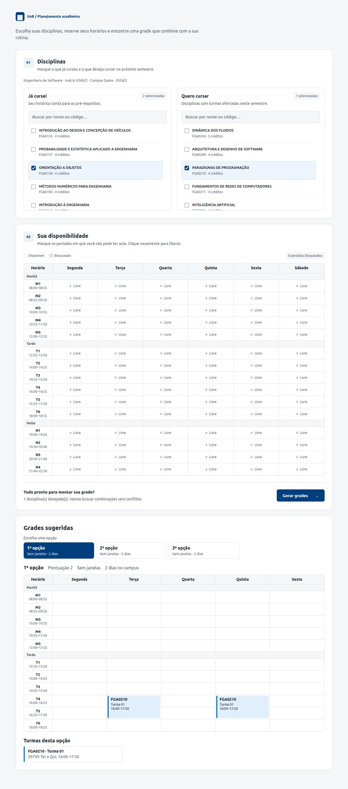

<!--
  RASCUNHO. Os campos entre [colchetes] precisam ser preenchidos pelo grupo.
  As referências arquivo:linha valem para o commit c75a6f6 + backend; confira
  de novo depois dos últimos merges. Rode `make validar` antes de entregar
  e apague este comentário.
-->

# Planejador Inteligente de Grade Horária da UnB

## 1. Identificação

| Nome completo | Matrícula | Turma (14h/16h) | Usuário GitHub |
|---------------|-----------|-----------------|----------------|
| [Nome]        | [000000]  | [14h]           | [@usuario]     |
| [Nome]        | [000000]  | [16h]           | [@usuario]     |
| [Nome]        | [000000]  | [14h]           | [@usuario]     |
| [Nome]        | [000000]  | [16h]           | [@usuario]     |
| [Nome]        | [000000]  | [14h]           | [@usuario]     |
| [Nome]        | [000000]  | [16h]           | [@usuario]     |
| [Nome]        | [000000]  | [14h]           | [@usuario]     |

- **Nome do projeto:** Planejador Inteligente de Grade Horária da UnB
- **Nome do grupo:** [nome criativo e único na turma]
- **Repositório:** [https://github.com/...]
- **Commit ou tag entregue:** [`v1.0`]
- **Ponto de partida:** [outro jogo conhecido]
  <!--
    O projeto não é um jogo, e a tabela do AVALIACAO.md (seção 1.5) só lista
    jogos. "outro jogo conhecido" (Δ = 0) parece a faixa mais próxima, mas
    CONFIRMEM COM O PROFESSOR. O validador só aceita uma das cinco faixas.
  -->
- **Slides da apresentação oral:** [`docs/apresentacao.pdf` | não há]

## 2. Resumo

O sistema monta grades horárias para alunos de Engenharia de Software da UnB
(FGA). O aluno informa as disciplinas que já cursou, as que deseja cursar e
os horários em que não pode ter aula. O motor em Prolog, usando restrições
CLP(FD), encontra todas as combinações de turmas sem choque de horário, com
pré-requisitos cumpridos, vagas disponíveis e créditos dentro do limite.
Depois ele ranqueia as combinações pelo número de janelas e de dias no campus
e devolve as cinco melhores, que a interface Elm mostra numa grade semanal.


<!-- Adicionem docs/captura.png quando a interface final estiver integrada. -->

## 3. Como executar

**Requisitos** (com as versões que o grupo usou):

- SWI-Prolog 11.0.1 (o comando `swipl` precisa estar no PATH; mínimo 9.1.22, por causa do janus)
- uv (ele instala o Python 3.12+ sozinho)
- Elm 0.19 e elm-test (`npm install -g elm elm-test`)
- GNU Make (opcional: os comandos equivalentes estão no `Makefile`)

**Instalação e execução:**

```sh
make install   # dependências Python (uv sync) e pacotes Elm
make start     # compila o Elm e sobe a API
```

Depois, abra http://localhost:8000. A documentação interativa da API fica em
http://localhost:8000/docs.

Sem `make`:

```sh
cd frontend && elm make src/Main.elm --optimize --output=build/index.html
cd ../backend && uv sync && uv run start
```

**Testes:**

```sh
make test      # plunit (51 casos) + elm-test
```

**Testado em:** [Linux (Pop!_OS), Windows, navegador]

## 4. Arquitetura

```
┌──────────────────┐  POST /api/gerar-grades  ┌──────────────────┐  janus  ┌──────────────────┐
│ Navegador (Elm)  │ ───────── JSON ────────▶ │ FastAPI (Python) │ ──────▶ │ SWI-Prolog       │
│ frontend/src/    │ ◀──────── JSON ───────── │ backend/         │ ◀────── │ prolog/          │
└──────────────────┘                          └──────────────────┘         └──────────────────┘
```

O mesmo servidor FastAPI entrega a página Elm compilada e a API. Por isso o
Elm usa uma URL relativa e não há configuração de CORS envolvida.

| Parte  | Responsabilidade | Arquivos principais |
|--------|------------------|---------------------|
| Prolog | Base de turmas, validação de choques, pré-requisitos e créditos, ranking das grades | `prolog/turmas.pl`, `prolog/regras.pl`, `prolog/ranking.pl` |
| Elm    | Estado da aplicação, leitura de horários SIGAA, decoders JSON e grade semanal | `frontend/src/Main.elm`, `frontend/src/Horario.elm`, `frontend/src/Semana.elm`, `frontend/src/GradeView.elm`, `frontend/src/Codec.elm` |
| Python | Só integração: recebe o JSON, consulta o Prolog e devolve o JSON | `backend/server.py` |

## 5. Parte em Prolog

### 5.1 Predicados principais

| Predicado | Local | O que faz |
|-----------|-------|-----------|
| `turma(?Codigo, ?Id, ?Professor, ?Horarios, ?Vagas)` | `prolog/turmas.pl:8` | Base de fatos das turmas ofertadas |
| `horario_slots(+Horario, -Slots)` | `prolog/regras.pl:31` | Converte um código SIGAA, como `24M34`, numa lista ordenada de slots inteiros, usando uma DCG |
| `apto(+Cursadas, +Codigo)` | `prolog/regras.pl:64` | Verdadeiro se a disciplina ainda não foi cursada e todos os pré-requisitos foram |
| `grade(+Cursadas, +Desejadas, +Bloqueados, +Min, +Max, -Grade)` | `prolog/regras.pl:86` | Gera, por backtracking, cada grade válida: uma turma por disciplina, sem choques, sem horários bloqueados e com créditos entre Min e Max |
| `compativeis(+OpcoesA, ?EscolhaA, +OpcoesB, ?EscolhaB)` | `prolog/regras.pl:120` | Restringe um par de escolhas de turma às combinações sem choque, com `tuples_in/2` |
| `metricas_grade(+Grade, -Janelas, -DiasCampus)` | `prolog/ranking.pl:21` | Conta as janelas entre a primeira e a última aula de cada dia e os dias com aula |
| `top_5_grades(+Cursadas, +Desejadas, +Bloqueados, -Top5)` | `prolog/ranking.pl:57` | Coleta todas as grades válidas, pontua com `7 × janelas + dias`, ordena e devolve as cinco melhores |

### 5.2 Conceitos do paradigma lógico utilizados

- [x] Fatos e regras como base de conhecimento: `disciplina/3`, `turma/5` e `prerequisito/2` em `prolog/turmas.pl:3`
- [x] Unificação e casamento de padrões: `turma_disponivel/4` desmonta o termo `turma/5` na cabeça da cláusula (`prolog/regras.pl:104`)
- [x] Recursão (inclusive sobre listas): `sem_choques/2` percorre a lista de disciplinas comparando cada uma com as seguintes (`prolog/regras.pl:115`)
- [x] Backtracking e múltiplas soluções: `grade/6` (`prolog/regras.pl:86`) produz uma grade por solução, e `label/1` enumera todas
- [x] `findall/3`, `bagof/3`, `setof/3` ou similares: `opcoes/3` (`prolog/regras.pl:101`) e `melhores_cinco/2` (`prolog/ranking.pl:66`)
- [x] Corte (`!`) ou negação (`\+`), e por que foram necessários: `apto/2` usa `\+ memberchk/2` para "ainda não cursada" (`prolog/regras.pl:67`); `digitos//1` usa corte para ler a maior sequência de dígitos (`prolog/regras.pl:46`)
- [x] Programação por restrições (CLP(FD) ou outra): domínios `Escolha in 1..N`, `tuples_in/2` para choques e `sum/3` para créditos (`prolog/regras.pl:74`, `prolog/regras.pl:110`, `prolog/regras.pl:120`)
- [x] Predicados de ordem superior (`maplist`, `include`, `call`): `maplist/3,4` em todo o `regras.pl`; `include/3` em `disciplinas_aptas/3` (`prolog/regras.pl:70`); `call/2` em `melhores_cinco/2`
- [x] Outro: gramática DCG para ler os horários SIGAA (`prolog/regras.pl:41`)

### 5.3 Trecho em destaque

```prolog
grade(Cursadas, Desejadas, Bloqueados, Minimo, Maximo, Grade) :-
    maplist(texto_atomo, Desejadas, Atomos),
    sort(Atomos, Codigos),
    maplist(apto(Cursadas), Codigos),
    total_creditos(Codigos, Total),
    Total #>= Minimo,
    Total #=< Maximo,
    horarios_slots(Bloqueados, SlotsBloqueados),
    maplist(opcoes(SlotsBloqueados), Codigos, Opcoes),
    maplist(escolha, Opcoes, Escolhas),
    sem_choques(Opcoes, Escolhas),
    label(Escolhas),
    maplist(nth1, Escolhas, Opcoes, Pares),
    pairs_keys(Pares, Grade).
```

(`prolog/regras.pl:86`)

O predicado não diz *como* procurar uma grade; ele declara o que uma grade
válida é. Cada disciplina vira uma variável `Escolha` cujo domínio é o
conjunto de turmas disponíveis (`escolha/2`). Para cada par de disciplinas,
`compativeis/4` declara, com `tuples_in/2`, quais pares de turmas não se
sobrepõem. Só depois de todas as restrições postas, `label/1` atribui valores.
O resolvedor CLP(FD) propaga as restrições e corta combinações impossíveis
antes de testá-las. Cada solução que o `label/1` encontra é uma grade, e o
backtracking entrega a próxima. É isso que permite ao `ranking.pl` coletar
todas com `findall/3` e escolher as melhores. Numa linguagem imperativa, isso
seria um laço aninhado com verificação de choque a cada passo.

## 6. Parte em Elm

### 6.1 Modelo e mensagens

```elm
type alias Model =
    { requisicao : Request
    , estado : Estado
    }

type Estado
    = Pronto
    | Carregando
    | Falhou String
    | Carregado (List Grade)

type Msg
    = GerarGrades
    | RecebeuResposta (Result Http.Error (List Grade))
```

(`frontend/src/Main.elm:17`)

O estado da requisição é um custom type, e não um conjunto de campos como
`carregando : Bool`, `erro : Maybe String` e `grades : List Grade`. Assim, é
impossível estar carregando e com erro ao mesmo tempo. Também não há como ter
grades sem uma resposta, e a `view` precisa tratar os quatro casos.

No domínio, `Horario.elm` torna `Periodo` e `Horario` tipos opacos
(`frontend/src/Horario.elm:136` e `frontend/src/Horario.elm:236`). A única forma
de obter um `Horario` é `deTexto : String -> Maybe Horario`, então um horário
inválido, como `8M9`, não existe dentro do programa. Na grade semanal, cada
célula é `Livre | Janela | Aula Turma | Choque (List Turma)`
(`frontend/src/Semana.elm:32`). Um choque é um caso próprio, e a tela não pode
esconder uma das turmas sem querer.

### 6.2 Conceitos do paradigma funcional utilizados

- [x] Arquitetura Elm (Model, update, view): `frontend/src/Main.elm:62` e `frontend/src/Main.elm:105`
- [x] Custom types e `case` exaustivo: `Dia`, `Turno` (`frontend/src/Horario.elm:26`, `frontend/src/Horario.elm:93`), `Conteudo` (`frontend/src/Semana.elm:32`), `Estado` (`frontend/src/Main.elm:23`)
- [x] `Maybe` e `Result` no lugar de null e exceções: `deTexto` devolve `Maybe Horario`; a resposta HTTP chega como `Result Http.Error` (`frontend/src/Main.elm:32`)
- [x] Funções de ordem superior e aplicação parcial: `lerTodos (lerPeriodo valor)` em `frontend/src/Horario.elm:243`; `List.map viewResumoGrade` em `frontend/src/Main.elm:146`
- [x] Composição (`|>`, `>>`): `Horario.codigoSlot >> Encode.string` em `frontend/src/Codec.elm:31`
- [x] Decoders e encoders JSON: `frontend/src/Codec.elm:70`, com o decoder `opcional` para campos que podem faltar (`frontend/src/Codec.elm:112`)
- [x] Comandos e subscriptions (efeitos controlados): `Http.post` só sai como `Cmd Msg` do `update` (`frontend/src/Main.elm:77`)
- [x] Imutabilidade e atualização de records: `{ model | estado = Carregando }` em `frontend/src/Main.elm:66`
- [ ] Outro: [preencher, se houver]

### 6.3 Trecho em destaque

```elm
deTexto : String -> Maybe Horario
deTexto texto =
    let
        ( digitosDias, resto ) =
            separarDigitos (String.toList texto)
    in
    case resto of
        letra :: digitosPeriodos ->
            Maybe.map2
                (\diasLidos periodosLidos ->
                    Horario texto (combinar diasLidos periodosLidos)
                )
                (lerTodos lerDia digitosDias)
                (turnoDaLetra letra
                    |> Maybe.andThen
                        (\valor -> lerTodos (lerPeriodo valor) digitosPeriodos)
                )

        [] ->
            Nothing
```

(`frontend/src/Horario.elm:243`)

O código SIGAA tem três partes: os dígitos dos dias, a letra do turno e os
dígitos dos períodos. Cada leitura pode falhar e devolve `Maybe`. O
`Maybe.andThen` encadeia "ler o turno" e "ler os períodos daquele turno", e o
`Maybe.map2` só monta o `Horario` se as duas metades derem certo. Não há
nenhum `if` de validação nem `Maybe.withDefault`: um único dígito inválido
faz o resultado inteiro ser `Nothing`, e o decoder JSON transforma isso em
erro de decodificação (`frontend/src/Codec.elm:95`).

## 7. Integração

| Rota / chamada | Entrada | Saída | Predicado Prolog |
|----------------|---------|-------|------------------|
| `POST /api/gerar-grades` | `{"cursadas": [...], "desejadas": [...], "bloqueados": ["2M3"], "peso_janelas": 3, "peso_dias": 2}` | `{"grades": [{"rank", "score", "janelas", "dias_campus", "turmas": [{"codigo", "turma", "horarios"}]}]}` | `ranking:top_5_grades/4` |
| `GET /api/saude` | nada | `{"status": "ok"}` | nenhum |

O `backend/server.py` carrega `prolog/ranking.pl` com `janus.consult` e
faz uma única consulta (`backend/server.py:39`). O `findall/3` dentro da
consulta transforma os termos `resultado/4` e `turma/5` em listas, que o
janus converte direto para listas Python. Entrada vazia devolve 400, tipos
errados devolvem 422 (validação do Pydantic), e "nenhuma grade compatível" é
uma lista vazia, não um erro.

## 8. Testes e validação

- **plunit:** 51 casos (`tests/prolog/regras.plt` com 22 e `tests/prolog/ranking.plt` com 29). Cobrem a leitura de horários, choques, pré-requisitos, limites de créditos, horários bloqueados, turmas sem vaga, cálculo de janelas e dias, e a ordem do Top 5.
- **elm-test:** quatro suítes em `frontend/tests/`. Cobrem a leitura de horários (`HorarioTest.elm`), a montagem da semana com janelas e choques (`SemanaTest.elm`), encoders e decoders do contrato (`CodecTest.elm`) e a grade com o seletor Top 1 a 5 (`GradeViewTest.elm`).
- **API (manual, com curl):** os três cenários abaixo foram conferidos contra o Prolog real.
- **Casos de borda considerados:**
  - `FGA0158` cursada, pedindo `FGA0210` e `FGA0244`: três grades, com pontuações 4, 4 e 24.
  - O mesmo pedido com o bloqueio `2M3`: uma grade, com as turmas B.
  - `FGA0210` sem ter cursado `FGA0158`: nenhuma grade.
  - Disciplina inexistente ou horário inválido: lista vazia, sem erro 500.
  - Turma com zero vagas: nunca aparece (`FGA0124` A).
  - Nenhuma disciplina desejada: erro 400 com mensagem.

## 9. Limitações e problemas conhecidos

- [Atualizar depois dos merges] O `Main.elm` ainda mostra só um resumo textual das grades. A grade semanal (`GradeView.elm`) e os filtros de entrada (branch `pessoa-5-elm-entrada`) ainda não estão ligados a ele.
- `Types.elm` e `Codec.elm` definem duas vezes os tipos e decoders do contrato JSON. Só o `Codec.elm` valida os horários com o tipo `Horario`.
- A base `prolog/turmas.pl` tem 4 disciplinas e 8 turmas demonstrativas, e não as cerca de 25 disciplinas reais planejadas.
- `peso_janelas` e `peso_dias` são aceitos pela API, mas ignorados: o Prolog usa sempre a pontuação `7 × janelas + dias`.
- `top_5_grades/4` gera todas as grades válidas antes de ordenar. Com muitas disciplinas e muitas turmas cada, o número de combinações cresce de forma exponencial.
- Os limites de créditos (2 a 32) são fixos em `prolog/regras.pl:19`. A interface não permite mudá-los.
- Não há testes automatizados da API em Python. Os cenários foram conferidos à mão.
- [O que o grupo faria com mais tempo.]

## 10. Contribuição de cada integrante

| Integrante | Principais contribuições |
|------------|--------------------------|
| [Nome]     | `prolog/regras.pl`: choques, pré-requisitos e créditos com CLP(FD) |
| [Nome]     | `prolog/ranking.pl`: métricas e Top 5 |
| [Nome]     | `backend/`: API FastAPI + janus; `prolog/turmas.pl`; `Makefile` |
| [Nome]     | `frontend/src/Main.elm` e `Types.elm`: arquitetura TEA e HTTP |
| [Nome]     | Filtros de entrada (seleção de disciplinas e bloqueio de horários) |
| [Nome]     | `Horario.elm`, `Semana.elm`, `GradeView.elm`, `Codec.elm` e testes Elm |
| [Nome]     | Testes plunit, integração, README e apresentação |

## 11. Fontes, código de terceiros e uso de IA

<!--
  TODO O GRUPO precisa revisar esta seção. Cada integrante deve dizer se usou
  IA e em quê. Não declarar anula o trabalho; declarar não tira pontos.
-->

**Código reaproveitado.** O projeto não partiu do código do template do
Sudoku, mas seguiu a mesma arquitetura (Elm, FastAPI com janus e SWI-Prolog).
O `Makefile` imita o do template. `scripts/validar_entrega.py` foi copiado
do repositório do professor, sem alterações.

**Referências.** Documentação do SWI-Prolog (CLP(FD), DCG, janus), guia oficial
do Elm, documentação do FastAPI e do uv, repositório
`fabiommendes/paradigmas-trabalho-final`. [Outras referências.]

**Uso de ferramentas de IA.**

- **Faixa de uso no código:** auxiliar

| Ferramenta | Para que foi usada | Como o grupo verificou o resultado |
|------------|--------------------|------------------------------------|
| Claude (Anthropic) | Auxílio na implementação da API (`backend/server.py`), do `Makefile` e do rascunho deste relatório. [Nome] começou o `server.py`, escolheu as tecnologias (FastAPI, uv e janus), tomou as decisões de projeto e orientou e revisou o que a ferramenta gerou | A API foi testada com curl contra o Prolog real; o relatório foi revisado pelo grupo; [completar] |
| [Ferramenta] | [Uso pelos outros integrantes] | [...] |

## 12. Apresentação oral

- **Slides:** [mesmo caminho indicado na seção 1, ou "não há"]
- **Roteiro:**

| Parte | Duração | Quem apresenta |
|-------|:-------:|----------------|
| Contexto e objetivo | 2 min | [Nome] |
| Demonstração | 5 min | [Nome] |
| Código Prolog | 3 min | [Nome] |
| Código Elm | 3 min | [Nome] |
| Limitações e aprendizados | 2 min | [Nome] |

## 13. Reflexão sobre os paradigmas

<!--
  Esta seção precisa ser escrita pelo grupo, com observações próprias e
  exemplos do código (AVALIACAO.md, critério 5, nível 4). Perguntas que ajudam:
  - O que ficou mais simples em Prolog do que seria numa linguagem
    imperativa? E o que ficou mais difícil?
  - O que o compilador do Elm impediu que desse errado?
  - Como a forma de pensar mudou entre as duas linguagens?
-->

[Reflexão.]
